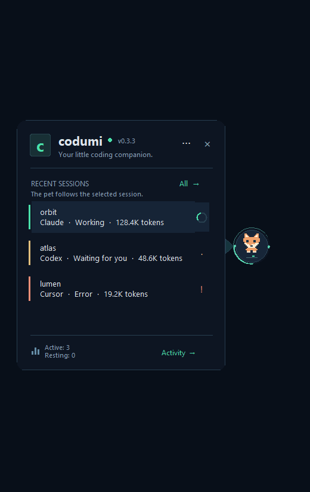
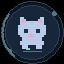
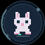
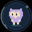

<div align="center">

# codumi ●

### Your little coding companion.

**Big ideas. Long builds. Tiny company.**

A little pet for the corner of your screen.<br>
A window into what your coding agents are doing.<br>
And a small celebration when the work is done.

**Windows x64 · Claude Code + Codex · 10 pets · 6 languages · MIT**

[**Adopt your codumi →**](https://github.com/hlatki01/codumi/releases/latest)<br>
[Meet the pets](#pick-your-deskmate) · [Get started](#from-download-to-deskmate) · [Contribute](#theres-room-for-one-more)



<sub>Actual Windows UI. Fictional sessions. Very real little companion.</sub>

</div>

---

## A tiny resident of your desktop

Your agent is thinking. Your terminal is busy. Your coffee is getting cold.

codumi keeps you company through all of it. It lives in a small floating bubble, follows your cursor with its eyes while working, and reveals your sessions when you hover. Move away, and the tray folds back into its little corner of the world.

Select a session to make it your pet's focus. A resting pet can have busy neighbors: **the pet follows the selected session**, while the tray shows everyone else.

| A little gesture | A little response |
| --- | --- |
| Say hello with your cursor | A small hop and a tray that springs open |
| Let an agent work | A moving activity ring and eyes following your mouse |
| Finish a task | A brief celebration |
| Take a break | A breathing, sleepy companion |
| Click four times in 1.2 seconds | A tumble, a few tears, and eventually back to business |
| Say goodbye | One last jump out of the bubble, then a shrinking exit |

Windows reduced-motion settings are respected. Personality should be comfortable, too.

## Pick your deskmate

Ten native pixel pets, one spot beside your work. These are their actual in-app working animations.

| | | | | |
| :---: | :---: | :---: | :---: | :---: |
| <br>**codumi** | <br>**Cat** | <br>**Dog** | <br>**Fox** | <br>**Rabbit** |
| <br>**Panda** | <br>**Frog** | <br>**Owl** | <br>**Robot** | <br>**Dragon** |

Choose one in **Settings → Pet**. Drag the bubble wherever it feels at home; codumi remembers its position.

## Small bubble. Useful view.

Hover to see your recent Claude Code and Codex sessions: project, provider, state, and token usage. Click a session for its latest prompt, elapsed time, exact token total, and recent activity. Click it again to fold the details away.

```text
orbit
Claude · Working · 128.4K tokens

atlas
Codex  · Resting · 48.6K tokens
```

The pet can show working, thinking, waiting, ready, resting, error, and context compaction, with a brief celebration on completion. The tray includes session filtering and activity counts. An optional always-on-top setting keeps your companion nearby.

**Want the original terminal?** Select a session and click **Focus terminal**. If discovery is ambiguous, use **Activity → Choose terminal window… → Use this window**. Windows may refuse activation, and selecting a particular terminal tab or pane is not automated. See the technical notes below.

## From download to deskmate

1. [Download the Windows x64 ZIP](https://github.com/hlatki01/codumi/releases/latest).
2. Extract the **entire folder** to a writable location.
3. Open **codumi.exe**.
4. Look to the right side of your screen. Hover to say hello.

Keep the executable, source files, and `runtime` folder together. Python and Tcl/Tk are bundled; monitoring local sessions needs no account, API key, or internet connection.

The executable is currently unsigned. Releases include a `SHA256SUMS.txt` file for checking the download.

### The little field guide

| You want to… | Here's how |
| --- | --- |
| See your sessions | Hover over the pet |
| Tuck the tray away | Leave the pet and tray for 250 ms |
| Move your companion | Drag the avatar |
| Open settings | Click **···** or right-click the pet |
| Pick a pet or language | Choose **Pet** or **Language** in settings |
| Expand or collapse a session | Click that session |
| Return to a terminal | Select a session, then click **Focus terminal** |
| Quit | Click **×**, choose **Quit codumi**, or use **Ctrl+Q** in the panel |

For keyboard access, enable **Keyboard navigation** in settings. Use Tab to move between controls, Space to activate, and Escape to dismiss the tray. Transparent space around the overlay lets clicks reach the application underneath.

If the app becomes unresponsive, `Fechar.cmd` closes only the Python process belonging to that distribution's runtime.

## Feels at home in your language

**English · Português · Español · Français · Deutsch · Italiano**

codumi follows your Windows **display language**, with English as the fallback. Prefer another language? Choose it in **Settings → Language**, or return to **Automatic (Windows)**. The change is immediate, saved, and includes the subtitle.

Project names, prompts, provider names, and tool identifiers keep their original text. Restart codumi after changing the Windows display language when using automatic selection.

## Your sessions stay on your machine

codumi reads local session transcripts. It does not install agent hooks, modify conversations, read authentication files, or send session data over the network. Prompts appear locally in the tray.

Preferences live beside the app in `preferences.json`; diagnostic errors go to `codumi.log`. Neither is included in Git or release archives.

<details>
<summary><strong>Under the bubble: session states, tokens, and terminal discovery</strong></summary>

### Where sessions come from

- Claude Code: `%USERPROFILE%\.claude\projects`, or `CLAUDE_CONFIG_DIR\projects`.
- Codex: `%USERPROFILE%\.codex\sessions`, or `CODEX_HOME\sessions`.

A background reader discovers up to 48 recently updated sessions, reads bounded JSONL tails, and follows complete appended lines.

States depend on events the agent records. Missing permission or reasoning events cannot be inferred reliably. Five minutes without new records makes a session appear resting; that does not prove its process has exited. Pet animations never change the agent's actual state.

### What the token number means

Token usage appears after session status. Codex uses the transcript's cumulative total. Claude sums input, output, cache-creation, and cache-read usage once per message, merging repeated streaming records.

Large Claude histories are counted in bounded background chunks without replacing live state. A **≥** prefix means older records are still being counted. Open session details for the unabridged number. When usage is absent, codumi does not invent a count; malformed or oversized records are skipped.

These are **processed-token totals across requests**, including cache usage, rather than the current context-window size. Claude's fields follow the [documented usage breakdown](https://platform.claude.com/docs/en/build-with-claude/prompt-caching).

### Returning to the original terminal

codumi uses Claude's session registry or the process holding Codex's writer file, checks process creation times, and looks for a visible console or terminal-host ancestor. Manual window associations last while codumi is open.

It does not open another shell or send commands to your session. Closed or editor-integrated sessions may have no usable terminal window. Windows can refuse foreground activation; selecting an exact tab or pane is not automated. Foreground activation still needs broader testing on regular user desktops.

</details>

## There's room for one more

**Everyone is welcome to contribute.** First pull request? Favorite language missing? An animation idea? A monitor setup that does something strange? We'd love the help.

| Your kind of contribution | A good place to start |
| --- | --- |
| 🐛 Find a bug | [Open an issue](https://github.com/hlatki01/codumi/issues) with steps to reproduce |
| 🌍 Give codumi more words | Improve or add translations in `locales.json` |
| ✨ Give it more personality | Refine sprites, motion, or reduced-motion behavior |
| ♿ Make it easier to use | Improve keyboard access, readability, or accessibility |
| 🖥️ Give it a new environment | Test monitors, scaling, and terminal hosts |
| 📝 Explain something better | Improve the docs, examples, or onboarding |

Read [CONTRIBUTING.md](CONTRIBUTING.md), pick something small, and send a pull request. Please keep discussions kind and remove private conversations, paths, and credentials from reports.

<details>
<summary><strong>Build a little companion of your own: development, tests, and packaging</strong></summary>

### Run from source

Use **Windows x64 and Python 3.10+ with Tcl/Tk**. The application has no PyPI dependencies.

```powershell
git clone https://github.com/hlatki01/codumi.git
cd codumi
python app.py
```

To explore with fictional sessions, without reading real agent history:

```powershell
python app.py --demo
```

### Check your changes

```powershell
python -m unittest discover -v
python check_ui.py
python check_locales.py
python check_pet_motion.py
python check_settings_reaction.py
python check_terminal.py
python check_terminal_picker.py
python check_exit.py
python check_tokens.py
python app.py --demo --smoke-test
```

Native checks create temporary windows and preferences. Run them on Windows with Tcl/Tk. Foreground and Restart Manager checks can be restricted on sandboxed desktops. [VALIDATION.md](VALIDATION.md) records the evidence and limits, including areas needing broader testing: clean installations, ARM64, physical mixed-DPI monitors, screen readers, and prolonged resource use.

No linter is configured. Check syntax with:

```powershell
python -m py_compile app.py desktop.py pet.py sessions.py i18n.py terminal.py build.py
```

### Package for Windows

Use Python with Tcl/Tk and the .NET Framework 4.x C# compiler included with Windows:

```powershell
python build.py
```

Output: `dist/codumi-Windows/codumi.exe` and `dist/codumi-Windows-x64.zip`. Existing output directories are never overwritten. Choose a fresh directory for another build:

```powershell
python build.py --output dist/my-build/codumi-Windows
```

The ZIP includes source, licenses, documentation, and a local Python/Tcl/Tk runtime. It excludes preferences, logs, and Python caches.

### Find your way around

| File | What lives here |
| --- | --- |
| `app.py` | Floating windows, tray, settings, selection, and preferences |
| `pet.py` | Ten native sprites and retained-canvas animations |
| `desktop.py` | Win32 behavior, monitor geometry, input regions, and spring motion |
| `sessions.py` | Read-only Claude/Codex transcript adapters |
| `terminal.py` | Terminal discovery, identity checks, and focus requests |
| `i18n.py`, `locales.json` | Windows language detection and translations |
| `Launcher.cs`, `build.py` | Windows launcher and portable packaging |

</details>

---

<div align="center">

**A small companion. An open invitation.**

Application code and sprites released under the [MIT license](LICENSE).<br>
Inspired by [Notchi, by sk-ruban](https://github.com/sk-ruban/notchi), and built independently for Windows.<br>
No upstream code or sprites are included; codumi is not an official Notchi distribution.

<sub>Bundled runtime licenses: <a href="THIRD_PARTY.md">THIRD_PARTY.md</a> and runtime/LICENSE.txt in the portable download.</sub>

**See you in the corner of your screen. ●**

</div>
